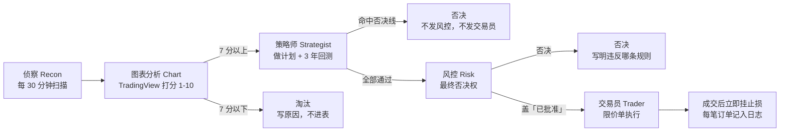

# AI 交易台

Chen 的 A 股模拟交易台，由 Muse 担任交易幕僚长管理。沪深都做，2 万元模拟盘，短线 T+1、持仓 1-3 天。

> 数据快照：2026-11-10 收盘。现金 20,000 元，持仓 0/5，累计 0 笔交易。
> 规则变更（Chen 2026-11-10 18:22 / 18:23）：资金由 10,000 元上调到 20,000 元，单笔含成本止损上限 200 元（1%），单日上限 400 元（2%），买入日总预算 16,000 元。21 支候选的决策记录按决策当时 10,000 元口径原样保留。
> 本仓库是交易台的规则、流程、回测代码和决策记录。五个 Bot 是 Muse 里的独立对话（见 `roles.md`），不在本仓库里运行；定时任务是 Muse 的 cron（见 `schedules.md`）。

## 流水线



- **侦察**：交易时段每 30 分钟扫描一次，找异动及原因，只送有来源的发现。
- **图表分析**：用 TradingView 查日线/4 小时趋势、支撑阻力、RSI、50/200 日均线、量能，1-10 分打分；7 分以上才送策略师。
- **策略师**：给每个 7 分以上标的做计划（入场、止损、目标、仓位），用同一套规则在至少 3 年数据上回测（含手续费和滑点）。
- **风控**：否决权是最终的。合规则盖「已批准」并送交易员。
- **交易员**：只执行「已批准」的计划，限价单，成交后立即挂止损。

交接格式：`标的 | 点子 | 证据 | 下一步`

## 可视化工作流

- 交互版：打开 `dashboard/index.html` 的「可视化工作流」一节，点任意一支候选，看它在侦察 → 图表 → 策略师 → 风控 → 交易员每个环节的 verdict（通过 / 否决 / 没走到），还能按否决原因筛选（最近一年亏损 / 止损超线 / 笔数不足 / 特定参数 / 预算超线）。
- 文字版：见 `workflow.md`，有 Mermaid 流程图、各环节职责表、策略师否决线，以及两个完整走完的真实例子（华策影视 300133、富瀚微 300613）。
- 截至 2026-11-10 收盘：21 支进表候选全部在策略师环节被否决，风控收到 0 支，交易员下单 0 单。

## 规则

见 `rules.md`。核心：单笔最多亏 1%、单日最多亏 2%、最多同时 5 个仓位；绝不碰仙股、杠杆、财报前、美联储和 CPI 公布当天；每个判断都要有来源和时间戳，绝不编造价格、数字或结果。

## 否决线（策略师）

出现以下任何一条，直接否决，不发风控：

1. 回测少于 30 笔
2. 最近一年不赚钱
3. 只在某一组特定参数下才有效

止损按**含成本的实际亏损**算（佣金 0.025% 最低 5 元、卖出印花税 0.05%、过户费 0.001%、滑点每边 0.1%），超过单笔 1% 即否决。

## 目录

| 路径 | 内容 |
|---|---|
| `trading-log.md` | 交易日志：规则、账户状态、每笔候选的计划与否决原因、每周复盘、每日收盘小结 |
| `watchlist.md` | 自选股 |
| `backtest/backtest-template.py` | 回测模板（佣金、印花税、过户费、滑点口径） |
| `backtest/backtest-*.py` | 各标的的回测脚本 |
| `backtest/data/` | 各标的 3 年前复权日线（CSV）与回测结果（JSON），东财数据 |
| `plans/` | 策略师给每支过图候选做的计划 |
| `scans/` | 侦察每 30 分钟扫描记录 |
| `briefs/` | 每日交易早报 |
| `schedules/` | 定时任务定义（早报、收盘报告、每周复盘、30 分钟扫描、16:15 止损检查） |
| `roles.md` | 五个 Bot 的角色任务书 |
| `rules.md` | 交易台完整规则 |
| `workflow.md` | 可视化工作流：Mermaid 流程图、各环节职责、两个完整走完的真实例子 |
| `dashboard/index.html` | 可视化界面（单文件静态页，可直接用 GitHub Pages 发布），含交互式工作流：点候选看完整旅程、按否决原因筛选 |

## 可视化界面

打开 `dashboard/index.html` 即可看：账户概览、**可视化工作流（点候选看完整旅程、按否决原因筛选）**、流水线漏斗、全部候选的评分与否决原因、否决原因分布、规则卡片。数据来自 `trading-log.md`，快照时间 2026-11-10 收盘；规则数字已按 2026-11-10 晚的变更更新为 20,000 元 / 200 元 / 16,000 元，候选表按决策当时口径原样保留。

## 运行回测

```bash
python3 backtest/backtest-template.py
```

模板只在合成数据上验证过可运行；各标的脚本用 `backtest/data/` 里的真实日线跑。

## 已知局限

- 20 日均量在 TradingView 上读不到，量能对比用 30 日均量或目测近期量柱，并注明。
- 「Desk Signal」指标在 TradingView 上不可见，从不编造信号。
- 行情看板（中国股市行情看板）是 Muse 里的服务端实时页面，不在本仓库内。
- 本系统是模拟盘，不产生真实交易。
