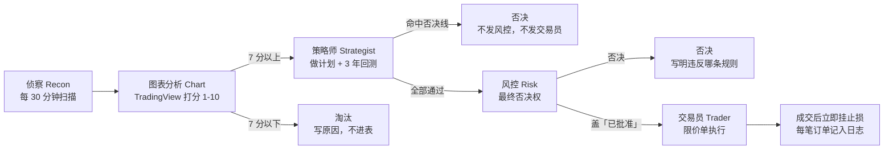

# 可视化工作流

一支候选从被发现到下单（或被否决），必须走完五个环节，一步都不能跳。
交互版见 `dashboard/index.html` 的「可视化工作流」一节：点任意一支候选，看它在每个环节的 verdict。

## 流程图



## 各环节是干什么的

| 环节 | 负责人 | 输入 | 输出 | 通过标准 |
|---|---|---|---|---|
| 侦察 | 交易台-侦察 | 新闻、公告、板块异动、资金流向 | 有来源的发现，按 `标的 \| 点子 \| 证据 \| 下一步` 交接 | 有来源才送；无信号报「无信号」，不硬凑 |
| 图表分析 | 交易台-图表分析 | 侦察的发现 | 1-10 分 + 3 行说明 | 7 分以上送策略师；7 分以下淘汰并写原因 |
| 策略师 | 交易台-策略师 | 7 分以上的形态 | 计划（入场、止损、目标、仓位）+ 3 年回测 | 见下「否决线」；通过的才发风控 |
| 风控 | 交易台-风控 | 策略师的计划 | 「已批准」戳 + 时间戳，或否决 | 单笔/单日风险、持仓相关性、财报与美联储/CPI 事件全过 |
| 交易员 | 交易台-交易员 | 风控「已批准」的计划 + Chen 点头 | 订单与成交确认 | 限价单；成交后立即挂止损；超入场价 0.5% 不追 |

## 策略师否决线（命中任何一条即否决）

1. 回测少于 30 笔
2. 最近一年不赚钱
3. 只在某一组特定参数下才有效

止损按**含成本的实际亏损**算（佣金 0.025% 最低 5 元、卖出印花税 0.05%、过户费 0.001%、滑点每边 0.1%），超过单笔 1% 即否决。单笔上限：2026-11-10 18:22 前为 100 元（资金 10,000 元），之后为 200 元（资金 20,000 元）。

## 走一遍：两个真实例子

### 华策影视 300133（2026-11-10，图表 8 分，今日最高分）

```
侦察：传媒抱团核心延续 → 图表：8 分通过（盘中 10.85 元，突破 9.8-10.4 元阻力，放量 2-3 倍）
  → 策略师：计划入场 10.85、止损 10.00、目标 12.55（2R）、100 股
    → 含成本止损 0.98%，合规通过
    → 回测：62 笔，最近一年 23 笔 -167.26 元，不赚钱 ✗
    → 参数敏感性：只在目标抬到 2.5R/3R 时最近一年勉强打平（+39.56/+41.87 元，3 年总盈亏仍为负）
      → 踩中第三条否决线（只在某一组特定参数下才有效），未改目标凑通过
  → 风控：没走到 ✗ → 交易员：没走到 ✗
```

### 富瀚微 300613（2026-11-10，图表 7 分）

```
侦察：端侧 AI 板块大涨 → 图表：7 分通过（20cm 涨停封死，盘中 80.02 元）
  → 策略师：计划入场 80.02、止损 69.00、目标 102.06（2R）、100 股
    → 预算：100 股成本 8,002 元，按当时 8,000 元总预算超 2 元，且无法减仓 ✗
    → 含成本止损约 1,130.50 元（11.30%），远超单笔 1% 线 ✗
    → 回测：33 笔，最近一年 12 笔 -200.00 元，不赚钱 ✗
  → 风控：没走到 ✗ → 交易员：没走到 ✗
```

## 截至 2026-11-10 收盘的流程状态

- 进表候选 21 支（11-08：2 支；11-09：8 支；11-10：11 支），图表 7 分以上全部通过
- 策略师否决 21 支，全部没发风控；风控收到 0 支，交易员下单 0 单
- 否决原因分布：最近一年回测不赚钱 21 支；含成本止损超 1% 线 12 支；回测少于 30 笔 5 支；只在特定参数下有效 1 支；100 股成本超周三预算 1 支（同一支可命中多条；按决策当时 10,000 元口径统计）
- 流程完整，无断点：11-08 周复盘发现的交接断点（长江电力 8 分通过后策略师当晚仍未收到）已修复，改为图表 7 分以上由幕僚长当天直接转策略师，不等汇总

## 怎么用这个工作流

- 新候选进来时，按上图一步一步走，每步的结论和证据写进 `trading-log.md`，再同步到 `dashboard/index.html` 的候选数据（`CANDS` 数组）和下表
- 图表 7 分以下淘汰的标的不进候选表，原因写在 `scans/` 的扫描记录里
- 规则变更时（如 2026-11-10 资金上调），在 `rules.md`、`trading-log.md` 和看板顶部的变更横幅里同步改，历史决策记录按决策当时的口径原样保留，不改写
